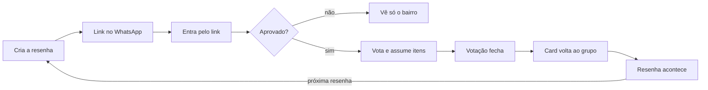

# Resenha — Documento de Requisitos

Fonte original: doc "Resenha — Documento de Requisitos" no claude.ai, versão de 18/10/2026. Mudanças de requisito são feitas aqui, por PR, e espelhadas no doc.

## 1. Visão do produto

A Resenha é um web app que transforma o caos do "bora fazer uma resenha?" no grupo do WhatsApp em uma decisão rápida, visual e divertida, decidida por votação da galera.

**Problema.** Todo rolê entre amigos começa com cem mensagens no grupo: onde, que horas, quem vai, quem leva o quê, rateio ou cada um com o seu. Nada se conclui, o organizador se estressa e a informação se perde.

**Proposta.** O organizador cria a resenha em segundos e manda o link no grupo. A galera entra sem instalar nada, vota e se oferece para levar coisas. Quando a votação fecha, o app gera um card pronto que volta para o grupo com um toque.

**Por que resenha e não festa.** Festa é grande e rara. Resenha é pequena e frequente (o pré, o churrasco, o "cê tá on hoje?"), o que dá recorrência semanal.

**Público.** Adolescentes e jovens de 15 a 19 anos (idade mínima de uso: 15), organizados em grupos fixos de amigos e turmas, que já combinam tudo pelo WhatsApp.

**Função matadora.** A votação da resenha que vira card. O resto (feed, apostas, ranking) existe para gerar zoeira e recorrência em volta dela.

## 2. Gatilhos do público e como viram função

| Gatilho | O que significa | Função no produto |
| --- | --- | --- |
| Pertencimento | Fazer parte da galera | Grupo fixo, "quem tá on", fotos de quem confirmou |
| FOMO | Medo de ficar de fora | Contador ao vivo de confirmados |
| Validação rápida | Ser visto e aprovado | Reações, curtidas, ranking de melhor momento |
| Zoeira e identidade | Linguagem própria do grupo | Apostas sobre a resenha, troféus positivos |
| Disputa | A decisão como jogo | Votação animada com placar ao vivo |
| Efêmero | Urgência de estar lá agora | Fotos do feed que somem em 24 horas |
| Atrito zero | Entrar sem esforço | Link do WhatsApp abre direto |

Toda zoeira é sobre a resenha ou sobre ações combinadas, nunca sobre características de pessoas (seção 9).

## 3. Estratégia com o WhatsApp

O WhatsApp é o canal de distribuição: o app organiza e zoa, o grupo espalha. A Resenha só tira do grupo a dor (votação perdida, "quem leva o quê" sumindo no histórico, ninguém sabendo quem vai de fato).

- **Entrada pelo organizador:** o alvo de aquisição é quem sempre puxa o rolê; ele traz o grupo inteiro.
- **A isca é o print:** card de resultado e cards de grupo são feitos para compartilhar no grupo e no story.
- **Web antes de app:** MVP é PWA que abre direto do link. App nativo só depois de validar recorrência.

## 4. Papéis

| Papel | Quem é | O que pode fazer |
| --- | --- | --- |
| Organizador | Quem cria a resenha | Criar, editar, abrir e fechar votações, aprovar ou remover pessoas, encerrar |
| Anfitrião | Quem oferece o lugar (pode ser o organizador) | Liberar o endereço exato, aprovar quem entra, remover e bloquear na resenha dele |
| Participante | Membro que entrou pelo link | Confirmar presença, votar, assumir itens, reagir (fase 2: apostar, postar fotos) |
| Responsável legal | Pai, mãe ou tutor de menor | Dar consentimento; fase 2: painel do responsável |
| Moderador da plataforma | Equipe da Resenha | Analisar e decidir denúncias da fila da plataforma |

A galera que sai junto é um **grupo** persistente. Cada resenha nasce dentro de um grupo.

## 5. Escopo por fase

| Fase | Entra | Critério para avançar |
| --- | --- | --- |
| MVP | Grupo, criar resenha, entrar pelo link, confirmar presença, votações (onde, horário, modelo de divisão), "quem leva o quê", card de resultado, endereço protegido, denúncia e bloqueio, consentimento parental | Grupos com 2+ resenhas no mês e organizadores trazendo 5+ pessoas |
| Fase 2 | "Quem tá on hoje", feed efêmero de fotos, reações, apostas, playlist colaborativa, painel do responsável | Retenção semanal dos grupos ativos estável por 8 semanas |
| Fase 3 | Troféus e ranking, retrospectiva do grupo, vaquinha via Pix, temas premium, eventos grandes | Base para monetizar sem quebrar o loop viral |

**Fora do escopo em qualquer fase:** busca pública de resenhas ou perfis, mensagens privadas entre desconhecidos, interações anônimas entre pessoas, votações sobre pessoas, publicidade direcionada a menores, venda de dados.

## 6. Requisitos funcionais

52 requisitos em 9 módulos. Fase: MVP, F2 ou F3. Critérios de aceite do MVP em `docs/spec.md`, seção 5.

### 6.1 Conta e acesso (ACE)

| ID | Requisito | Fase |
| --- | --- | --- |
| ACE-01 | Entrar pelo link do convite sem baixar app; o convidado informa apelido, foto e data de nascimento para participar | MVP |
| ACE-02 | Login por número de celular com código de uso único enviado pelo WhatsApp, sem senha | MVP |
| ACE-03 | Data de nascimento obrigatória no primeiro acesso, antes de qualquer interação; menos de 15 anos bloqueia | MVP |
| ACE-04 | Fluxo de consentimento do responsável para menores (15 a 17 anos), conforme parecer jurídico | MVP |
| ACE-05 | Perfil mínimo: apelido, foto, grupos; escola, endereço, idade e celular nunca visíveis a outros | MVP |
| ACE-06 | Excluir a conta e os dados pessoais pelo próprio app | MVP |

### 6.2 Grupos (GRP)

| ID | Requisito | Fase |
| --- | --- | --- |
| GRP-01 | Criar grupo com nome, foto e link de convite | MVP |
| GRP-02 | Entrar em grupo só por link; sem busca de grupos | MVP |
| GRP-03 | Admin do grupo aprova novos membros e remove membros | MVP |
| GRP-04 | Histórico das resenhas do grupo | MVP |
| GRP-05 | "Quem tá on hoje": membro marca disponibilidade e o grupo vê quem está livre | F2 |

### 6.3 Resenha (RES)

| ID | Requisito | Fase |
| --- | --- | --- |
| RES-01 | Criar resenha em até 3 toques: nome opcional, dia e quais votações abrir | MVP |
| RES-02 | Compartilhar no WhatsApp com um toque, com prévia do link | MVP |
| RES-03 | Confirmar presença: Vou, Talvez, Não vou | MVP |
| RES-04 | Lista de confirmados com fotos e contador ao vivo | MVP |
| RES-05 | Organizador aprova ou recusa quem pede para entrar, vendo de qual link veio e amigos em comum | MVP |
| RES-06 | Organizador remove alguém a qualquer momento | MVP |
| RES-07 | Encerrar a resenha: sai das ativas e vira histórico | MVP |
| RES-08 | Lembrete automático no dia para quem confirmou | F2 |

### 6.4 Votação (VOT)

| ID | Requisito | Fase |
| --- | --- | --- |
| VOT-01 | Votações padrão: onde, horário, modelo de divisão | MVP |
| VOT-02 | Modelos de divisão: rateio igual, cada um leva uma coisa, só bebida (com menor presente: "cada um com o seu") | MVP |
| VOT-03 | Participante sugere opção nova, se o organizador permitir | MVP |
| VOT-04 | Placar ao vivo com barras e quem votou em quê | MVP |
| VOT-05 | Prazo de encerramento ou fechamento manual; empate decidido pelo organizador | MVP |
| VOT-06 | Opção vencedora vira automaticamente a regra da resenha | MVP |
| VOT-07 | Votações só sobre a resenha (lugar, hora, tema, itens); nunca sobre pessoas | MVP |
| VOT-08 | Votações extras livres (tema, dress code, playlist) | F2 |

### 6.5 Divisão e itens (DIV)

| ID | Requisito | Fase |
| --- | --- | --- |
| DIV-01 | Se "cada um leva": lista de itens que a galera assume | MVP |
| DIV-02 | Se "rateio": valor total estimado e valor por pessoa pelos confirmados | MVP |
| DIV-03 | Marcar item como garantido e ver o que falta | MVP |
| DIV-04 | Oferecer o lugar ("pode ser lá em casa") como opção de onde | MVP |
| DIV-05 | Vaquinha via Pix | F3 |

### 6.6 Card de resultado (CRD)

| ID | Requisito | Fase |
| --- | --- | --- |
| CRD-01 | Ao fechar as votações, gerar card com dia, hora, bairro, modelo e quem leva o quê | MVP |
| CRD-02 | Card em imagem para WhatsApp (1:1) e story (9:16) | MVP |
| CRD-03 | O card mostra só o bairro, nunca o endereço exato | MVP |
| CRD-04 | Cards de grupo ("a 7ª resenha de vocês este mês", recordes) | F2 |

### 6.7 Local e endereço (LOC)

| ID | Requisito | Fase |
| --- | --- | --- |
| LOC-01 | Antes da aprovação, mostrar só bairro ou região | MVP |
| LOC-02 | Endereço exato visível só a participantes aprovados e confirmados | MVP |
| LOC-03 | Endereço apagado 24 horas depois do encerramento | MVP |
| LOC-04 | "Abrir no mapa" só para quem vê o endereço | MVP |

### 6.8 Zoeira e engajamento (ZOE)

| ID | Requisito | Fase |
| --- | --- | --- |
| ZOE-01 | Reações rápidas em confirmações, votos e fotos | F2 |
| ZOE-02 | Apostas sobre a resenha, sem dinheiro e sem tema sobre aparência ou características | F2 |
| ZOE-03 | Playlist colaborativa | F2 |
| ZOE-04 | Feed efêmero do grupo: fotos que somem em 24 horas | F2 |
| ZOE-05 | Troféus positivos da resenha | F3 |
| ZOE-06 | Retrospectiva do grupo | F3 |

### 6.9 Segurança e moderação (SEG)

| ID | Requisito | Fase |
| --- | --- | --- |
| SEG-01 | Denunciar pessoa, conteúdo ou resenha em até 2 toques | MVP |
| SEG-02 | Bloquear alguém: um deixa de ver e interagir com o outro | MVP |
| SEG-03 | Filtro automático de texto ofensivo em nomes, opções e comentários | MVP |
| SEG-04 | Fila de moderação da plataforma com prazo de resposta definido; o anfitrião vê as denúncias da resenha dele | MVP |
| SEG-05 | Moderação automática de imagens antes de publicar | F2 |
| SEG-06 | Painel do responsável legal | F2 |

## 7. Fluxo principal e telas

| Tela | Para que serve | Requisitos | Fase |
| --- | --- | --- | --- |
| Bora? (início do grupo) | Puxar uma resenha; ver quem tá on | RES-01, GRP-05 | MVP (tá on: F2) |
| Criar resenha | Dia, votações a abrir, endereço protegido | RES-01, VOT-01, LOC-01 | MVP |
| Página da resenha | Confirmar presença, votar, placar, confirmados | RES-03, RES-04, VOT-04 | MVP |
| Quem leva o quê | Itens ou rateio conforme o modelo vencedor | DIV-01 a DIV-04 | MVP |
| Gestão do organizador | Aprovar pedidos, remover pessoas, fechar votações | RES-05, RES-06, VOT-05 | MVP |
| Card de resultado | Imagem para o grupo e o story | CRD-01 a CRD-03 | MVP |
| Feed do grupo | Fotos efêmeras, reações | ZOE-01, ZOE-04 | F2 |

As telas visuais adaptadas para resenha ainda não existem (ver `docs/questoes-em-aberto.md`).

## 8. Requisitos não funcionais

Critério principal: do link no WhatsApp ao primeiro voto em menos de 15 segundos.

| ID | Área | Requisito |
| --- | --- | --- |
| RNF-01 | Desempenho | Página da resenha carrega em menos de 2 s em 4G num celular intermediário |
| RNF-02 | Tempo real | Votos, confirmações e itens aparecem para todos em menos de 1 s |
| RNF-03 | Plataforma | PWA responsivo, feito primeiro para celular; Android e iOS pelo navegador |
| RNF-04 | Compartilhamento | Links com prévia (Open Graph) para WhatsApp, Instagram e TikTok |
| RNF-05 | Disponibilidade | 99,5% ao mês; pico em sextas e sábados à noite |
| RNF-06 | Escala | Resenhas de até 100 pessoas e grupos de até 200 membros |
| RNF-07 | Segurança | HTTPS em tudo, dados criptografados em repouso, endereços com acesso restrito |
| RNF-08 | Privacidade | Coletar o mínimo; retenção definida por tipo de dado |
| RNF-09 | Acessibilidade | Contraste AA, áreas de toque de 44 px, leitor de tela |
| RNF-10 | Idioma | Português do Brasil com a linguagem da galera, sem soar infantil |
| RNF-11 | Dados no Brasil | Postgres gerenciado na região de São Paulo, em conformidade com a LGPD |
| RNF-12 | Observabilidade | Métricas de funil e de convite desde o primeiro dia |

## 9. Segurança, proteção de menores e conformidade

### 9.1 Base legal

- **ECA Digital (Lei 15.211/2025):** proteção de crianças e adolescentes em serviços digitais (verificação de idade, supervisão parental, configurações protetivas por padrão, canais de denúncia). Obrigações exatas a validar com advogado.
- **LGPD (Lei 13.709/2018):** tratamento de dados de menores no melhor interesse deles; consentimento específico do responsável quando exigido.
- **ECA (Lei 8.069/1990):** proteção integral.

Estas referências não substituem parecer jurídico, que é condição para o lançamento.

### 9.2 Regras anti-bullying

- Nenhuma interação anônima entre pessoas.
- Votações, apostas e troféus só sobre a resenha, nunca sobre pessoas.
- Troféus só positivos.
- Remover ou bloquear alguém não gera aviso público.

### 9.3 Proteção física

- Acesso só por link e aprovação; nada encontrável por busca.
- Endereço exato só para aprovados e confirmados, apagado 24 h após o encerramento.
- Sem localização em tempo real de pessoas.
- Sem mensagens privadas entre quem não está no mesmo grupo.

### 9.4 Checklist de conformidade para o lançamento

- [ ] Parecer jurídico sobre ECA Digital e LGPD (faixa etária e consentimento)
- [ ] Política de privacidade e termos em linguagem simples, com versão para responsáveis
- [ ] Verificação de idade e consentimento parental implementados
- [ ] Configurações mais protetivas por padrão para menores
- [ ] Canal de denúncia, fila de moderação e prazo de resposta definidos
- [ ] Procedimento para reportar conteúdo ilegal às autoridades
- [ ] Tabela de retenção por tipo de dado e exclusão de conta funcionando
- [ ] Encarregado de dados (DPO) nomeado
- [ ] Relatório de impacto à proteção de dados (RIPD)
- [ ] Sem publicidade direcionada a menores e sem venda de dados

## 10. Decisões de produto já tomadas

| Decisão | Origem |
| --- | --- |
| Idade mínima de uso: 15 anos | Questão em aberto respondida em 18/10/2026 |
| Itens alcoólicos bloqueados e "só bebida" vira "cada um com o seu" quando há menor | Idem |
| Login pelo WhatsApp (não SMS) | Idem |
| O anfitrião modera a resenha dele; denúncias também vão para a fila da plataforma | Idem, complementado pela responsabilidade legal do provedor |
| Escolas e grupos do piloto | Marcado como resolvido no doc; detalhes fora deste repositório |

## 11. Métricas de sucesso

Métrica norte: resenhas decididas por semana (votação fechada e card gerado).

| Métrica | Meta inicial do piloto |
| --- | --- |
| Resenhas decididas por semana | Crescimento semana a semana |
| Coeficiente viral (K) | Acima de 1 |
| Convidados por resenha | 8 ou mais |
| Link → primeiro voto em menos de 15 s | 60% ou mais |
| Resenhas por grupo no mês | 2 ou mais |
| Organizadores que repetem em 30 dias | 50% |
| Cards compartilhados por resenha | 1 ou mais |
| Denúncias por mil usuários ativos | Acompanhar e investigar toda alta |

## 12. Monetização

MVP 100% grátis. A partir da fase 3: eventos grandes pagos pelos pais, taxa pequena na vaquinha via Pix, temas e cards premium. Nenhuma função de segurança atrás de pagamento.

## 13. Riscos

| Risco | Mitigação |
| --- | --- |
| A galera prefere decidir no WhatsApp | Atacar só a dor; card volta ao grupo; entrada sem instalar |
| Cyberbullying | Sem anonimato, nada sobre pessoas, denúncia, filtro, moderação |
| Exposição de endereço | Só para aprovados, apagado em 24 h, sem busca |
| ECA Digital e LGPD | Parecer jurídico antes do piloto; checklist 9.4 |
| Atrito do consentimento parental | Fluxo simples por link enviado ao responsável |
| Modismo passageiro | Recorrência semanal e novidades por fase |
