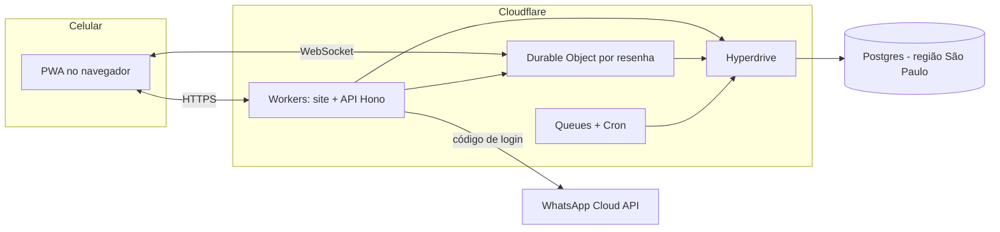

# Especificação técnica do MVP

O MVP roda no Cloudflare com TypeScript de ponta a ponta e Postgres na região São Paulo. Decisões registradas nos ADRs 0001 a 0004 (`docs/adr/`). Mudar qualquer item desta página exige um novo ADR aprovado.

## 1. Stack

| Camada | Escolha | Por quê |
| --- | --- | --- |
| Linguagem | TypeScript (strict) no front, na API e nos testes | Um idioma só, fácil de contratar |
| Front-end | React + Vite como PWA, servido como assets estáticos do Workers | Abre direto do link do WhatsApp, instalável, sem loja |
| API | Hono no Cloudflare Workers | Leve, parecido com Express, roda na borda |
| Tempo real | Durable Objects com WebSocket, um objeto por resenha | Placar, confirmados e itens ao vivo |
| Banco | Postgres gerenciado na região São Paulo, acessado via Hyperdrive | Dados de menores no Brasil; banco conhecido e portável |
| Acesso ao banco | Drizzle ORM + migrações versionadas | Tipos gerados do schema, migrações revisáveis em PR |
| Validação | Zod em `packages/shared` | Mesmas regras no front e na API |
| Login | Código de uso único pelo WhatsApp Cloud API (Meta); sessão em cookie httpOnly | Decisão de produto; sem senha |
| Anti-robô | Cloudflare Turnstile no login e na criação de resenha | Grátis, sem captcha |
| Card em imagem | PNG gerado no Worker (Satori / workers-og) | Card pronto para WhatsApp e story |
| Arquivos | R2 | Fase 2 para o feed; uso no MVP depende de decisão (fotos de perfil, ver questões em aberto) |
| Tarefas assíncronas | Cloudflare Queues + Cron Triggers | Apagar endereço em 24 h, expirar códigos, notificações |
| Erros e métricas | Workers Logs; ferramenta de erros em avaliação (Sentry, questão #11); eventos de produto na tabela `events` | Funil e coeficiente viral desde o dia 1 |
| Código e deploy | GitHub + Wrangler, deploy por GitHub Actions | Preview por PR, produção pelo `main` |
| Testes | Vitest com pool de Workers; Playwright | API, Durable Objects e fluxos no celular |

O provedor exato do Postgres gerenciado (ex.: Supabase, Neon) ainda não foi escolhido; o requisito é região São Paulo, Postgres 15+ e compatibilidade com Hyperdrive. Ver `docs/questoes-em-aberto.md`.

## 2. Arquitetura

- O Postgres é a fonte da verdade. O Durable Object da resenha mantém o estado ao vivo (votos, confirmações, itens) e grava no Postgres a cada mudança; se o objeto reiniciar, recarrega do banco.
- Toda checagem de permissão acontece no Worker ou no Durable Object, nunca só no front.
- O endereço exato nunca é enviado por WebSocket a quem não tem permissão (LOC-01, LOC-02).

## 3. Decisões de produto que afetam o código

| Decisão | Regra no código |
| --- | --- |
| Idade mínima de 15 anos | Data de nascimento obrigatória no primeiro acesso; menos de 15 recusa sem gravar dados pessoais. De 15 a 17, conta de menor, com consentimento do responsável conforme parecer jurídico |
| Sem álcool para menores | Se qualquer participante aprovado for menor, "só bebida" vira "cada um com o seu" e itens com termos da categoria álcool são bloqueados |
| Login pelo WhatsApp | Código de 6 dígitos por template de autenticação; validade de 10 min; 5 tentativas erradas bloqueiam por 15 min; até 3 códigos por número a cada 15 min e 10 por IP a cada hora (IP guardado só como hash). Sessão de 30 dias, renovada com o uso (decidido em 21/10/2026) |
| Convidado sem login | Até 10 convidados criados por IP a cada hora (IP guardado só como hash; decidido em 22/10/2026) |
| Grupos | Só por link: "meus grupos" lista apenas os grupos em que a pessoa é membro aprovada. Criar e entrar em grupo exige login com celular (o convidado sem celular é só para resenha). Quem foi recusado ou removido não pode pedir de novo pelo mesmo link. Conta excluída sai dos grupos; se era o único admin, a administração passa ao membro aprovado mais antigo. Até 200 membros aprovados (RNF-06). Sem foto até a questão #4 (decidido em 22/10/2026) |
| Moderação | O anfitrião remove e bloqueia na resenha dele e vê as denúncias dela. Toda denúncia também vai para a fila da plataforma |

Nome do produto em aberto: no código, usar `resenha` como nome provisório, configurável.

## 4. Entregas do MVP em ordem

Cada entrega é um PR revisável, publicado num preview testável no celular antes da próxima começar.

1. **Fundação (local).** Monorepo, Workers + Vite + Hono rodando localmente com Wrangler, Postgres 16 em container (Docker Compose), Drizzle com a primeira migração reproduzindo `docs/db/schema.sql`, CI no GitHub Actions só com lint e testes. Página inicial e `/api/health` funcionando em `localhost`. Sem deploy, sem Hyperdrive de produção e sem contas de nuvem nesta fase.
2. **Acesso.** Login por código no WhatsApp, Turnstile, sessão, data de nascimento, bloqueio abaixo de 15, consentimento do responsável, perfil mínimo, excluir conta. ACE-01 a ACE-06.
3. **Grupos.** Criar grupo, link de convite, entrar só por link, aprovação e remoção, histórico. GRP-01 a GRP-04.
4. **Resenha.** Criar em 3 toques, compartilhar com prévia, Vou / Talvez / Não vou, pedidos de entrada e aprovação, encerrar. RES-01 a RES-07.
5. **Votação ao vivo.** Durable Object por resenha, votações padrão, sugestão de opção, placar em tempo real, prazo e fechamento, vencedora vira regra. VOT-01 a VOT-07.
6. **Divisão e local.** Itens, rateio, oferecer a casa, regra sem álcool para menores, endereço só para aprovados, apagado em 24 h. DIV-01 a DIV-04, LOC-01 a LOC-04.
7. **Card.** PNG ao fechar a votação, formatos 1:1 e 9:16, só com o bairro. CRD-01 a CRD-03.
8. **Segurança e lançamento.** Denúncia, bloqueio, filtro de texto, fila de moderação, eventos de métricas, revisão do checklist de conformidade. SEG-01 a SEG-04, RNF-12.

As entregas 2 a 7 dependem da anterior. A 8 pode começar em paralelo a partir da 4.

## 5. Critérios de aceite do MVP

Cada critério vira ao menos um teste automatizado. Os marcados (manual) são verificados no celular, no preview.

| ID | Dado / quando | Então |
| --- | --- | --- |
| ACE-01 | Pessoa sem conta abre o link de uma resenha | Vê a resenha e participa informando apelido, foto e nascimento, sem instalar nada |
| ACE-02 | Pessoa informa o celular e o código recebido no WhatsApp | Entra; código expira em 10 min; 5 tentativas erradas bloqueiam por 15 min |
| ACE-03 | Pessoa informa nascimento com menos de 15 anos | Cadastro recusado, sem gravar dados pessoais |
| ACE-04 | Pessoa de 15 a 17 anos se cadastra | Conta marcada como menor e fluxo de consentimento disparado conforme regra jurídica |
| ACE-05 | Alguém abre o perfil de outra pessoa | Vê só apelido, foto e grupos em comum |
| ACE-06 | Usuário pede para excluir a conta | Dados pessoais apagados em até 24 h; votos e itens ficam como "ex-participante" |
| GRP-01 | Usuário cria grupo | Grupo criado com link de convite único; criador vira admin |
| GRP-02 | Alguém tenta achar um grupo sem o link | Nenhuma rota lista ou busca grupos |
| GRP-03 | Pessoa entra pelo link do grupo | Fica pendente até um admin aprovar; admin pode remover a qualquer momento |
| GRP-04 | Membro abre o grupo | Vê as resenhas passadas, da mais nova para a mais antiga |
| RES-01 | Organizador cria uma resenha | Pronta em até 3 toques, com as votações escolhidas abertas (manual) |
| RES-02 | Organizador toca em compartilhar | Abre o WhatsApp com o link; a prévia mostra nome, dia e bairro, nunca o endereço |
| RES-03 | Participante responde Vou, Talvez ou Não vou | A resposta aparece para todos em menos de 1 s e pode ser trocada |
| RES-04 | Alguém confirma | Contador e fotos dos confirmados atualizam ao vivo para todos |
| RES-05 | Pessoa fora do grupo pede para entrar | Organizador vê de qual link veio e amigos em comum; sem aprovação, não vê endereço nem lista completa |
| RES-06 | Organizador remove alguém | A pessoa perde o acesso na hora, sem aviso público |
| RES-07 | Organizador encerra a resenha | Sai das ativas e entra no histórico |
| VOT-01 | Resenha criada com votações padrão | Existem as votações onde, horário e modelo de divisão |
| VOT-02 | Abre a votação de modelo | Opções: rateio igual, cada um leva uma coisa, só bebida (ou "cada um com o seu" se houver menor) |
| VOT-03 | Participante sugere opção com a sugestão liberada | A opção entra depois de passar no filtro de texto |
| VOT-04 | Alguém vota | Placar atualiza para todos em menos de 1 s, com quem votou em quê; um voto por pessoa, trocável até fechar |
| VOT-05 | Prazo vence ou organizador fecha | Votação trava; em empate, o organizador escolhe |
| VOT-06 | Votação fecha | A vencedora vira a regra da resenha e libera a lista de itens correspondente |
| VOT-07 | Alguém tenta criar opção sobre uma pessoa | O filtro bloqueia nomes e menções a participantes em opções de voto |
| DIV-01 | "Cada um leva" venceu | Participantes criam e assumem itens; no máximo um responsável por item |
| DIV-02 | "Rateio" venceu e há valor total | Valor por pessoa = total ÷ confirmados, recalculado a cada confirmação |
| DIV-03 | Item marcado como garantido | Lista mostra o que falta em destaque |
| DIV-04 | Participante oferece a casa | A casa vira opção na votação de onde, mostrando só o bairro |
| CRD-01 | Todas as votações fecharam | Card com dia, hora, bairro, modelo e quem leva o quê |
| CRD-02 | Usuário baixa ou compartilha o card | PNG 1080×1080 e 1080×1920 |
| CRD-03 | Qualquer card gerado | Nunca contém o endereço exato |
| LOC-01 | Pessoa não aprovada abre a resenha | Vê só o bairro; a API não devolve o endereço |
| LOC-02 | Pessoa aprovada e confirmada abre a resenha | Vê o endereço exato |
| LOC-03 | Passam 24 h do encerramento | Endereço apagado do banco por tarefa agendada |
| LOC-04 | Quem vê o endereço toca em "abrir no mapa" | Abre o app de mapas no endereço |
| SEG-01 | Alguém denuncia pessoa, conteúdo ou resenha | Denúncia em até 2 toques, na fila da plataforma |
| SEG-02 | Usuário bloqueia alguém | Um deixa de ver e interagir com o outro em todas as resenhas |
| SEG-03 | Texto ofensivo em nome, opção ou comentário | Bloqueado antes de salvar, com mensagem amigável |
| SEG-04 | Denúncia entra na fila | Moderador da plataforma vê, decide e registra; o anfitrião vê só as da resenha dele |

## 6. Convenções do time

- **Repositório:** monorepo com pnpm workspaces: `apps/web`, `apps/api`, `packages/db`, `packages/shared`.
- **Ambientes:** por enquanto só local (Wrangler + Postgres em container). Preview por PR, staging e produção serão definidos junto com a hospedagem (ADRs 0005 e 0006, adiados).
- **Desenvolvimento local:** o Wrangler roda Workers e Durable Objects na máquina; no local, a conexão com o Postgres é direta (o Hyperdrive aceita uma string de conexão local para desenvolvimento). Nada do código pode depender de serviço de nuvem para rodar localmente. Por isso, no local o Turnstile fica em modo de desenvolvimento (sem verificação; a verificação real é testada com a resposta da Cloudflare simulada) e o código de login do WhatsApp aparece no console do Wrangler, sem o celular.
- **Segredos:** só em Wrangler secrets e GitHub Actions secrets.
- **Branches e PRs:** um branch por entrega; PR revisado por uma pessoa; descrição lista os IDs atendidos.
- **Testes:** cada critério de aceite vira ao menos um teste.
- **Dados:** toda mudança de schema por migração, refletida em `docs/db/schema.sql`; nenhum dado pessoal em log.
- **Tecnologia nova:** só com ADR aprovado (ver `CLAUDE.md`).
